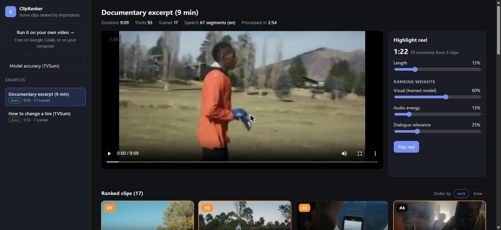
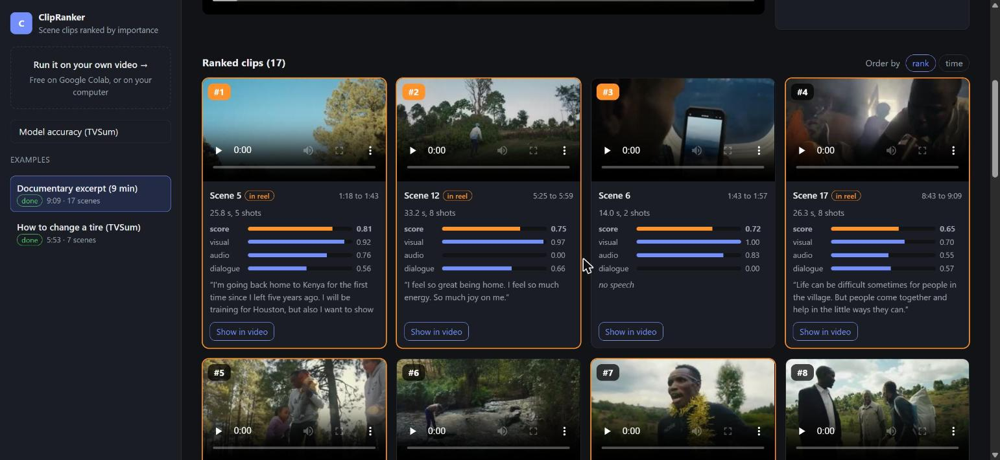
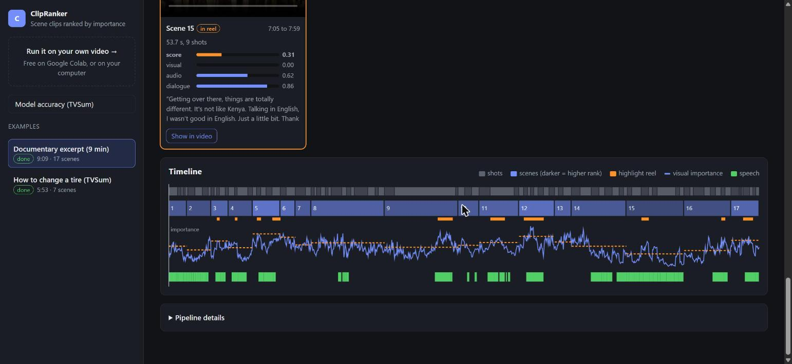
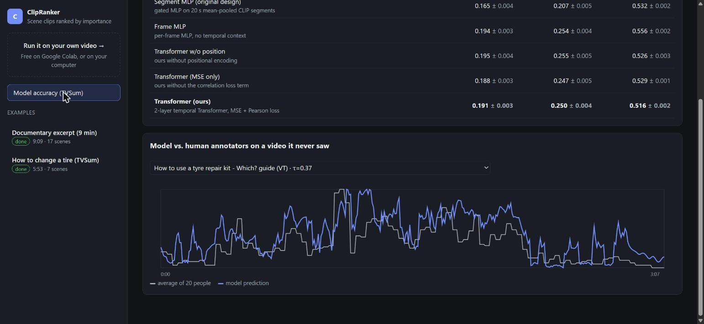

# ClipRanker: Semantic Video Synthesis

Give it a long video and it finds the scenes, cuts each scene out as its own clip, and ranks
the clips from most to least important. It also puts the best moments together into a short
highlight reel.

**Live demo:** https://kshitizrajpaudyal.com.np/clipranker

**Run it on your own video for free:** [Open in Colab](https://colab.research.google.com/github/Kshitiz726/Semantic-Video-Synthesis-with-BERT/blob/main/notebooks/ClipRanker_Colab.ipynb)

Best Project on Campus, and presented at the 4th Thapathali Graduate Conference.



## Screenshots

Every scene becomes its own clip, ranked from most to least important. Each card shows the
clip, its scores for picture, sound and speech, and what is said in it.



The timeline shows every shot, the scenes they were grouped into, the importance curve, the
moments picked for the highlight reel, and where people are speaking.



The accuracy page compares the model with human annotators on videos it never saw in training.



## How it works

1. **Shots.** TransNetV2 finds every cut. Frames are read at the video's real frame rate, so
   the timestamps are exact.
2. **Speech.** Whisper writes down what is said, with timings.
3. **Scenes.** Neighbouring shots are compared on what they show (CLIP image embeddings) and
   what is said (Sentence-BERT embeddings). Where both change a lot, a new scene starts. A
   scene never starts in the middle of a sentence; such boundaries are moved to the nearest
   sentence break.
4. **Clips.** Every scene is cut out as an MP4.
5. **Ranking.** Each clip gets three scores. The visual score comes from a model trained on
   the TVSum benchmark. The audio score looks at loudness and sound events. The dialogue score
   measures how close the clip's speech is to the main topic of the video. The three are
   combined with weights you can change in the app.
6. **Highlight reel.** The most important shots are picked to fill a length budget (15% of
   the video by default).

## How accurate is the ranking?

The visual model was tested on TVSum with 5-fold cross-validation, so every video was scored
by a model that never saw it. TVSum has importance ratings from 20 people for every frame.

| | Kendall τ | Spearman ρ |
|---|---:|---:|
| Two people compared with each other | 0.177 | 0.204 |
| The project's original design | 0.165 | 0.207 |
| **Our model** | **0.191** | **0.250** |

So the model agrees with human raters about as well as they agree with each other, and is
significantly better than the original design (p = 0.009). Full details, the ablations,
per-category results and the limits are in [docs/MODEL.md](docs/MODEL.md).

The scene segmentation step has not been measured against ground truth yet, because TVSum has
no scene labels.

## Run it yourself

You need Python 3.10 or newer. An NVIDIA GPU makes it about ten times faster but is not required.

```bash
conda create -n svs python=3.10 -y
conda activate svs
pip install torch torchvision --index-url https://download.pytorch.org/whl/cu121
pip install -r requirements.txt
python scripts/download_weights.py
```

Start the web app and open http://127.0.0.1:8000

```bash
python -m app.server
```

Or process a video from the command line:

```bash
python -m svs.pipeline input.mp4 --out runs/my_video
```

This writes the clips to `runs/my_video/clips/`, the highlight reel to `summary.mp4`, and
everything else (shots, scenes, scores, transcript, timings) to `result.json`.

Settings you might want: `SVS_CACHE_DIR` sets where models are downloaded (default
`~/.cache/svs`), and `SVS_WHISPER_MODEL` picks the Whisper size (`small` on GPU, `base` on CPU).

## Retrain and re-evaluate the model

Download TVSum from https://people.csail.mit.edu/yalesong/tvsum/tvsum50_ver_1_1.tgz and unzip
it, including the zip files inside. Then:

```bash
python -m training.prepare_tvsum --tvsum_dir path/to/ydata-tvsum50-v1_1 --out data/tvsum_clip.h5
python -m training.train_importance --data data/tvsum_clip.h5
python -m training.export_results --data data/tvsum_clip.h5 --tvsum_dir path/to/ydata-tvsum50-v1_1
```

Training takes about an hour and a half on an RTX 3070. The last command rebuilds the tables
and the figures in `docs/figures/`.

## Hosting

The live demo is a static page in the portfolio site. It shows example videos that were
processed ahead of time, and everything on it (ranking weights, highlight reel length, the
timeline) runs in the browser. To build it again:

```bash
python scripts/export_frontend.py --out ../portfolio/public/clipranker     --sample runs/my_video "My video title"
```

To process new videos, run ClipRanker in Colab or on your own machine as described above.
The server also has a public mode (`SVS_PUBLIC=1`) with upload limits, per-browser privacy and
automatic cleanup, for anyone who wants to host it on their own server.

## Project layout

```
svs/        the pipeline: shots, speech, features, scenes, scoring, summary
app/        web server and the single page app
training/   TVSum preparation, training, evaluation and result export
notebooks/  Colab notebook that runs the whole app on a free GPU
scripts/    weight download and static site export
docs/       model card, audit of the old version, figures
weights/    trained ranking model
```

[docs/AUDIT.md](docs/AUDIT.md) lists what was wrong with the earlier version of this project
and how each problem was fixed. Numbers from the earlier version should not be reused.

## References

* Souček and Lokoč. TransNet V2: an effective deep network architecture for fast shot transition detection. 2020.
* Radford et al. Learning transferable visual models from natural language supervision (CLIP). ICML 2021.
* Radford et al. Robust speech recognition via large-scale weak supervision (Whisper). 2022.
* Reimers and Gurevych. Sentence-BERT. EMNLP 2019.
* Song et al. TVSum: summarizing web videos using titles. CVPR 2015.
* Potapov et al. Category-specific video summarization (KTS). ECCV 2014.
* Otani et al. Rethinking the evaluation of video summaries. CVPR 2019.
